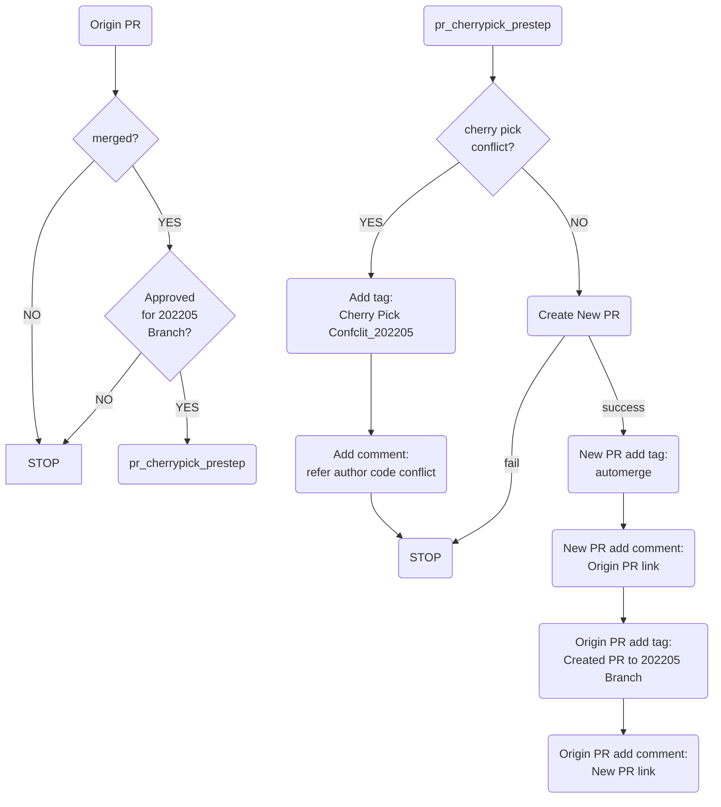
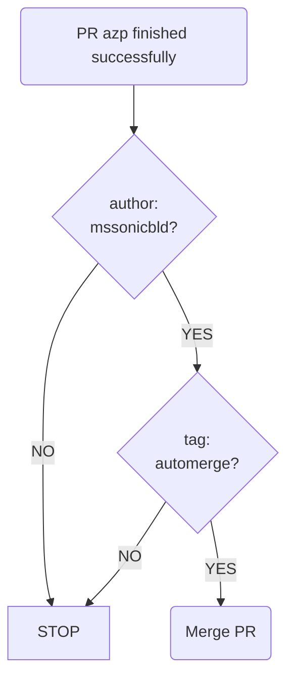
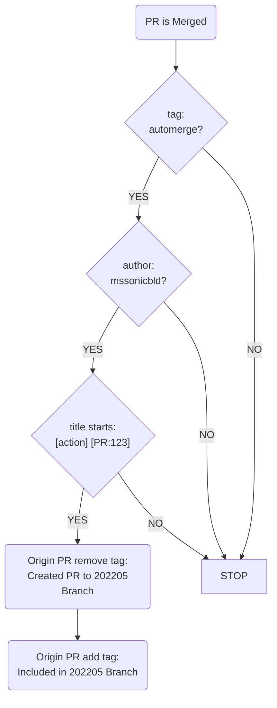

# GitHub Actions workflows

- [Minigraph retirement gate](#minigraph-retirement-gate)
- [Existing protection](#protected-configuration-files)
- [Auto-cherry-pick workflow](#auto-cherry-pick-workflow)

## Auto-cherry-pick workflow

The following examples use the `202205` branch.
1. pr_cherrypick_prestep:

2. automerge:

3. pr_cherrypick_poststep:

## Minigraph retirement gate

**Applies to pull requests targeting `master` in `sonic-buildimage`.**

The goal is to stop adding policy and dependencies to the legacy minigraph
configuration path while existing usage is migrated. A new parser default
or XML-based setup step adds more work to that migration and can introduce
another source of desired configuration.

**This check does not remove minigraph, change device behavior, or prove that
a configuration path is parser-free.** Existing consumers still need to work
until their replacements are qualified. Adding this workflow also does not,
by itself, make the check mandatory for merging.

### If your PR fails this check

1. Open the `minigraph-freeze` job and read the affected file and reason in
   **Check minigraph retirement policy**. The log links to this guide at your
   PR's exact revision; it does not post a separate PR comment.
2. For a frozen-file change, undo an accidental edit or request review of a
   necessary compatibility or retirement change. For an added dependency,
   replace the legacy usage with the appropriate configuration path described
   below. Do not move it to another file just to avoid the check.
3. If the finding looks incorrect, keep the relevant log and explain the
   intended behavior on the PR. An analysis error, checkout failure, or
   failing detector test is not evidence that your PR added a dependency;
   it must be investigated rather than treated as a successful check.

Do not weaken the detector, disable the workflow, or hide a legacy call to
make a PR pass. See [Questions and review](#questions-and-review) if you need
help choosing a replacement or explaining a finding.

### Protected paths and examples

Any addition, edit, deletion, rename, or mode change to these paths fails:

- `src/sonic-config-engine/minigraph.py`
- `src/sonic-config-engine/minigraph_ext.py`
- `src/sonic-config-engine/minigraph_custom.py`

The last path is an optional adapter and need not exist in a checkout.
Adding it is also checked; an adapter must not become a substitute place
for new parser policy.

| Proposed change | Expected result from this check |
| --- | --- |
| Add a platform-specific default to `minigraph.py`, or change a parser adapter. | Flagged: the parser and adapters are frozen. |
| Add a script that runs `sonic-cfggen -m` or `config load_minigraph`. | Flagged when statically recognized: this adds a legacy dependency. |
| Move an existing minigraph caller to a new file. | Flagged: new references are compared per file, not netted across the repository. |
| Remove an existing caller outside the frozen files without adding another legacy dependency. | Allowed by the detector; the replacement behavior still needs review and qualification. |
| Update Markdown documentation or an unrelated part of a non-frozen file without changing its detected dependencies. | No dependency violation; an analysis error can still fail the check. |

### Where should the change go instead?

- **Deployment-specific desired settings:** use the deployment's approved
  configuration producer and the desired CONFIG_DB JSON it supplies, often
  called golden configuration. Do not add a second default in the parser.
- **Lab-specific generation:** use the appropriate `sonic-mgmt` golden
  configuration generator rather than embedding lab policy in the image's
  parser. Existing lab generators may still consume minigraph; moving policy
  there is not, on its own, a parser-free migration.
- **Image or platform defaults:** obtain a separate ownership and application
  decision. This check does not require moving every default into golden
  configuration or removing `init_cfg.json.j2`. Do not use another image
  template or adapter merely to relocate the same competing policy.

For context on separating configuration policy from its consumer, see
[issue #28305](https://github.com/sonic-net/sonic-buildimage/issues/28305).

### Compatibility fixes, regression tests, and parser removal

A freeze must not prevent a necessary fix or the eventual removal of the
parser. However, these changes are not automatically exempt: even deleting
a frozen parser file fails, as does adding a recognized legacy call in a test.

Explain the exact change, why a legacy dependency is unavoidable or safe to
remove, the affected platforms/topologies, and the qualification evidence on
the PR. Qualification means preserving the relevant setup, expected
configuration, control/data-plane checks, and lifecycle/recovery behavior.
Skipping coverage or retaining an undisclosed minigraph fallback is not a
replacement.

**This patch provides no automatic exception mechanism.** Exception approvers
and a revision-scoped administrative process must be designated before the
check becomes mandatory. A contact's reply or a PR label does not make a
failed check pass or authorize a bypass.

### Questions and review

Use the PR discussion for technical questions and review decisions so the
context stays with the change. Include the failing job link, affected file,
reported reason, and intended behavior. If there is no PR yet, use a
[repository issue](https://github.com/sonic-net/sonic-buildimage/issues).

**Questions-only contacts:**

- Rithvick: [rimunagala@microsoft.com](mailto:rimunagala@microsoft.com)
- Vaibhav: [Vaibhav.Dixit@microsoft.com](mailto:Vaibhav.Dixit@microsoft.com)

These contacts can help clarify the guidance and route questions. Listing
them does not designate exception approvers or grant merge/bypass authority.
For code-review routing, see the repository's
[CODEOWNERS](https://github.com/sonic-net/sonic-buildimage/blob/master/.github/CODEOWNERS).
Keep any resulting technical decision on the PR; do not post secrets or
private operational data in public discussions.

Maintainer reference: exact coverage, limitations, and enforcement

### Detector behavior

For other changed files, `scripts/check_minigraph_freeze.py` compares counts
per file and reference between the event's base and test-merge snapshots.
It recognizes named Python parser imports/aliases, common command and file
APIs, simple literal bindings, visible shell commands, and common YAML command
blocks. It also checks literal minigraph XML access and new shipped
`minigraph.xml` files outside paths containing a `tests` component.

Mixed-purpose files are not frozen wholesale. Markdown/RST documentation and
Python comments/docstrings are ignored. Unused Python fixture/assertion
strings are not executed commands, but actual new imports/calls in tests are
not exempt. XML fixture exclusion is not a blanket exemption for test code.

### Limits of a passing check

This is a static guard, not a full call graph or proof of unchanged behavior.
Changes behind an existing reference, or moves within a file that keep
reference counts unchanged, may pass. Dynamic commands, complex data flow,
alternate parser implementations, binary artifacts, and submodule contents
are not fully covered. Shell heuristics can also flag ambiguous text.

Unsupported Python syntax, unparseable relevant shell commands, decoding
errors, or unavailable Git objects fail analysis rather than return a clean
result. Investigate these separately from policy violations.

Utilities CLI/migration and `sonic-mgmt` generation/setup/facts need companion
checks in their own repositories. This master-only check does not enforce
their policies or add release-branch coverage.

### Enabling mandatory enforcement

Before treating the freeze as a merge requirement, repository administrators
must:

1. Designate exception approvers and a controlled process tied to the exact
   reviewed revision, not all future pushes to the PR.
2. Protect workflow definitions, the detector, and policy/exception controls
   using a trusted required workflow or appropriate required review rules.
   A checker executed from the PR checkout is not independently tamper-proof.
3. Require **`minigraph-freeze` from GitHub Actions on `master` only**.
   Do not also require `check-file` on the assumption that its scope is the
   same; the image-default policy is separate.
4. Verify both an allowed PR and a deliberately blocked PR, and account for
   direct-push controls, bypass permissions, and any merge queue.

This patch does not change repository settings. The workflow is a PR check,
not a post-push audit; a red job alone does not guarantee that merging is
blocked.

## Protected configuration files

**Existing protection:** The `check-file` job remains separate. It retains
protection of `init_cfg.json.j2` and, on release branches, `minigraph.py`.
This minigraph rollout proposes requiring only `minigraph-freeze` on master;
it does not decide image-default ownership or introduce mandatory enforcement
of `check-file`.
