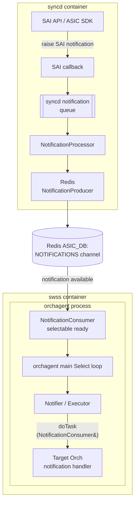
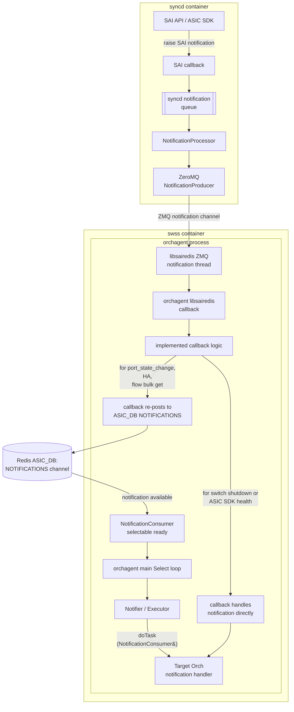
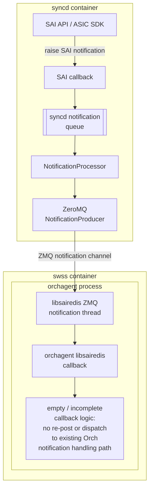
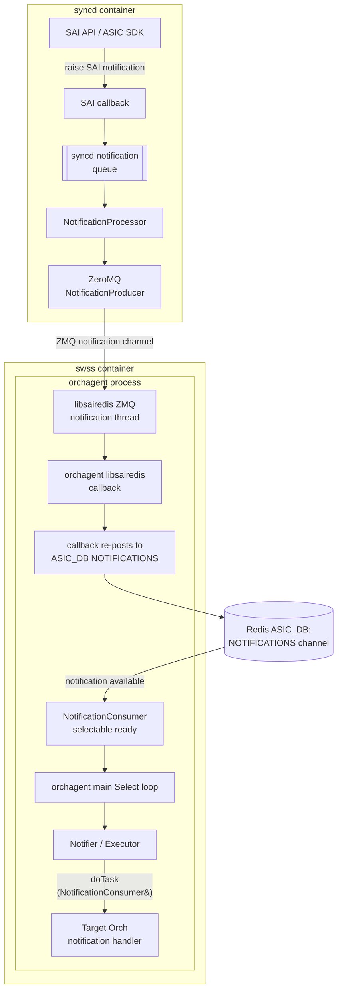
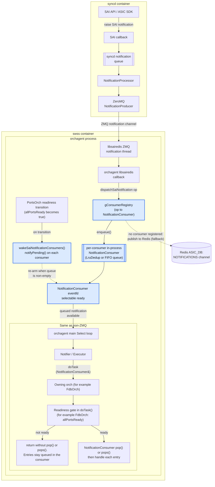
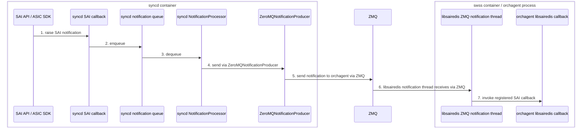
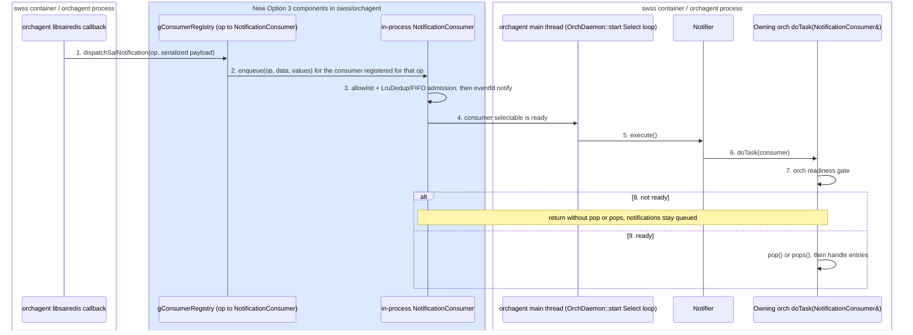
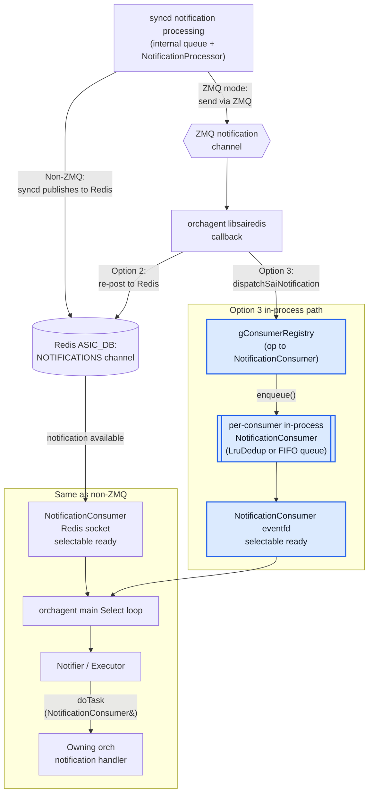
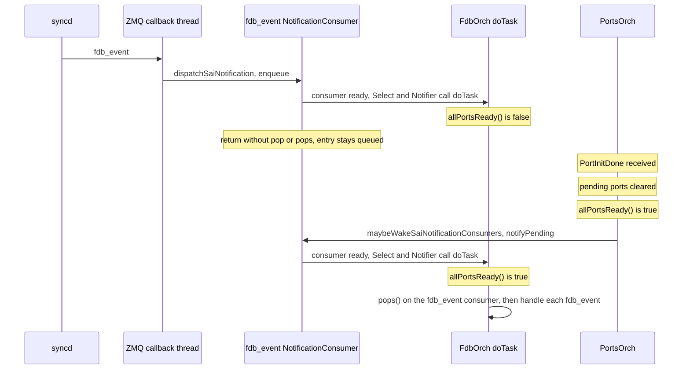
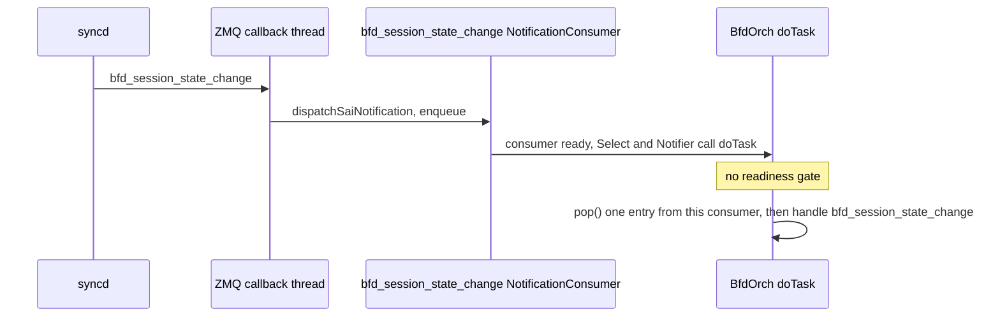

# HLD: SAI Notification Handling with ZMQ Southbound

## Table of Contents

- [1. Background](#1-background)
- [2. Problem Statement](#2-problem-statement)
- [3. Existing Notification Flows](#3-existing-notification-flows)
  - [3.1 Non-ZMQ Mode](#31-non-zmq-mode)
  - [3.2 ZMQ Mode Baseline](#32-zmq-mode-baseline)
    - [3.2.1 Notifications Already Handled](#321-notifications-already-handled)
    - [3.2.2 Notifications With Missing Callback Handling](#322-notifications-with-missing-callback-handling)
- [4. Design Goals](#4-design-goals)
- [5. Design Options](#5-design-options)
  - [5.1 Option 1: `syncd` Publishes Notifications via Redis in ZMQ Mode](#51-option-1-syncd-publishes-notifications-via-redis-in-zmq-mode)
    - [5.1.1 Description](#511-description)
    - [5.1.2 Notification Path](#512-notification-path)
    - [5.1.3 Implementation Notes](#513-implementation-notes)
    - [5.1.4 Pros](#514-pros)
    - [5.1.5 Cons](#515-cons)
  - [5.2 Option 2: `orchagent` Callback Re-posts to `ASIC_DB:NOTIFICATIONS`](#52-option-2-orchagent-callback-re-posts-to-asic_dbnotifications)
    - [5.2.1 Description](#521-description)
    - [5.2.2 Option 2 Flow](#522-option-2-flow)
    - [5.2.3 Implementation Notes](#523-implementation-notes)
    - [5.2.4 Pros](#524-pros)
    - [5.2.5 Cons](#525-cons)
  - [5.3 Option 3: In-process Notification Queue Drained by Orch Main Loop](#53-option-3-in-process-notification-queue-drained-by-orch-main-loop)
    - [5.3.1 Description](#531-description)
    - [5.3.2 Option 3 Flow](#532-option-3-flow)
    - [5.3.3 Option 3 Sequence](#533-option-3-sequence)
      - [5.3.3.1 ZMQ notification delivery to `orchagent` callback](#5331-zmq-notification-delivery-to-orchagent-callback)
      - [5.3.3.2 Callback to main-loop processing](#5332-callback-to-main-loop-processing)
    - [5.3.4 Notification Dispatch Path Comparison (Non-ZMQ, Option 2, and Option 3)](#534-notification-dispatch-path-comparison-non-zmq-option-2-and-option-3)
    - [5.3.5 Existing Code References](#535-existing-code-references)
    - [5.3.6 Implementation Notes](#536-implementation-notes)
    - [5.3.7 Main-loop Integration](#537-main-loop-integration)
    - [5.3.8 Readiness gates and boot-time behavior](#538-readiness-gates-and-boot-time-behavior)
      - [5.3.8.1 Readiness-gated boot-time sequence (example: port readiness)](#5381-readiness-gated-boot-time-sequence-example-port-readiness)
      - [5.3.8.2 Non-readiness-gated boot-time sequence](#5382-non-readiness-gated-boot-time-sequence)
      - [5.3.8.3 Readiness transition wake-up](#5383-readiness-transition-wake-up)
    - [5.3.9 Notification inventory](#539-notification-inventory)
    - [5.3.10 Priority, Fairness, and Queue Policy](#5310-priority-fairness-and-queue-policy)
    - [5.3.11 Validation and Unit Test Coverage](#5311-validation-and-unit-test-coverage)
    - [5.3.12 Pros](#5312-pros)
    - [5.3.13 Cons](#5313-cons)
    - [5.3.14 Follow-on work](#5314-follow-on-work)
  - [5.4 Recommendation](#54-recommendation)
- [6. References](#6-references)

## 1. Background

SONiC recently added support for ZMQ southbound communication between `orchagent` and `syncd` for regular switches. This is controlled by the route-performance ZMQ setting:

```text
SYSTEM_DEFAULTS|swss_zmq.status = enabled
```

In non-ZMQ mode (Redis mode), SAI notifications are published by `syncd` into Redis `ASIC_DB:NOTIFICATIONS`. `orchagent` consumes those notifications from Redis in its normal main loop and dispatches them to the appropriate Orch components.

In ZMQ mode, `syncd` sends notifications to `orchagent` through ZMQ. These notifications arrive in `orchagent` libsairedis callback functions. Some callbacks already re-post notifications to Redis, such as `on_port_state_change()`, but several are empty or incomplete. As a result, some notifications are dropped when ZMQ southbound is enabled. This gap is tracked in [sonic-buildimage issue #27541](https://github.com/sonic-net/sonic-buildimage/issues/27541).

**Baseline.** This HLD is written against the code before [sonic-swss PR #4619](https://github.com/sonic-net/sonic-swss/pull/4619) merged. That state is called the baseline. PR #4619 was later merged as the short-term fix and is **Option 2** in this HLD ([Section 5.2](#52-option-2-orchagent-callback-re-posts-to-asic_dbnotifications)). **Option 3** is evaluated against the same baseline and replaces the re-post. [Section 5.3.9](#539-notification-inventory) shows each notification's baseline path next to its Option 3 plan.

## 2. Problem Statement

When ZMQ southbound is enabled, SAI notifications delivered over ZMQ may not reach their existing Orch consumers. The primary gaps called out in [sonic-buildimage issue #27541](https://github.com/sonic-net/sonic-buildimage/issues/27541) are:

- `fdb_event`
- `bfd_session_state_change`
- `port_host_tx_ready`
- `icmp_echo_session_state_change`

Additional `ASIC_DB:NOTIFICATIONS` types should be reviewed for ZMQ-mode parity with the existing non-ZMQ Redis path, including `port_state_change` (re-posted to Redis in the baseline), `twamp_session_event`, and MACsec post-status notifications.

Expected consumers include `FdbOrch`, `BfdOrch`, `PortsOrch`, `IcmpOrch`, `TwampOrch`, and `MACsecOrch`, depending on platform and feature coverage.

Without a fix:

- Hardware-learned MAC entries may not propagate to `FdbOrch`.
- BFD session state transitions may not reach `BfdOrch`.
- Port host TX readiness may not reach `PortsOrch`.
- ICMP echo session monitoring may not reach `IcmpOrch`.
- Other `ASIC_DB:NOTIFICATIONS` types covered by this HLD (for example `twamp_session_event`, MACsec post-status, and HA/flow-bulk events; see [Section 5.3.9](#539-notification-inventory) for the full set) may be dropped or may not reach their owning orchs when ZMQ southbound is enabled.

This HLD does not change notification channels outside `ASIC_DB:NOTIFICATIONS` SAI delivery, such as `RESTARTCHECK` (`SwitchOrch`) or `APPL_DB` requests such as `WATERMARK_CLEAR_REQUEST` (`WatermarkOrch`). These are out of scope because they are not delivered via syncd SAI notifications over ZMQ; they continue to use their existing Redis consumers unchanged in ZMQ mode.

Notification prioritization and timely handling of high-priority notifications, such as port state changes and BFD session state changes, under high `orchagent` load is a broader concern for both ZMQ and non-ZMQ modes. This HLD considers that concern only in the context of the ZMQ notification handling [design options](#5-design-options); it does not propose changes to the existing non-ZMQ notification path.

## 3. Existing Notification Flows

The diagrams below show notification delivery paths at a high level. Where thread context affects the design, the text calls out the relevant execution contexts, such as the libsairedis notification thread and the `orchagent` main loop.

### 3.1 Non-ZMQ Mode



The non-ZMQ notification path has three main execution hops:

- `SAI API / ASIC SDK` invokes the registered notification callback in `syncd`.
- The `syncd` SAI callback enqueues the notification on the internal `syncd` notification queue; `NotificationProcessor` dequeues and publishes the notification to `ASIC_DB:NOTIFICATIONS`.
- `orchagent` main `Select` loop detects the ready `NotificationConsumer` selectable and dispatches the corresponding `Notifier` / executor. `Notifier::execute()` calls the corresponding Orch `doTask(NotificationConsumer&)`, which handles the notification through the existing Orch handler logic.

This is the existing proven notification path.

### 3.2 ZMQ Mode Baseline

In the baseline, ZMQ mode has notification handling gaps. Some notifications already have callback handling logic, while the notifications covered by this HLD do not reach their existing Orch consumers.

#### 3.2.1 Notifications Already Handled



In ZMQ mode, notifications that already have callback handling follow one of the existing callback-specific paths:

- Some callbacks re-post the notification to `ASIC_DB:NOTIFICATIONS`. From there, the existing Redis notification consumer path is used: the `orchagent` main `Select` loop detects the ready `NotificationConsumer` selectable and dispatches the corresponding `Notifier` / executor. `Notifier::execute()` calls the corresponding Orch `doTask(NotificationConsumer&)`, which handles the notification through the existing Orch handler logic.
- Other callbacks, such as switch shutdown or ASIC SDK health handling, are handled directly by callback-specific logic.

#### 3.2.2 Notifications With Missing Callback Handling



In this case, ZMQ transport delivers the notification to the `orchagent` libsairedis notification thread, which invokes the registered `orchagent` libsairedis callback. The callback does not re-post or dispatch the notification to the existing Orch notification handling path. Because that re-post/dispatch is missing in the baseline, the notification is dropped.

## 4. Design Goals

- Preserve existing non-ZMQ behavior.
- Restore missing notifications in ZMQ mode for the covered `ASIC_DB:NOTIFICATIONS` SAI notification types, while leaving notifications that already use direct callback handling unchanged.
- Avoid duplicate notification delivery.
- Preserve existing Orch handler behavior, including per-orch readiness rules in `doTask(NotificationConsumer&)`.
- Keep Orch state updates on the `orchagent` main-loop path.
- Preserve Redis `NotificationConsumer` behavior where notification dispatch is reused or replaced: consumer isolation, coalescing policy (LruDedup vs FIFO), Select scheduling semantics, `hasCachedData()` behavior, and `COUNTERS_DB:NOTIFICATION_CONSUMER_STATS` field schema.

## 5. Design Options

This section compares three alternative ways to deliver `ASIC_DB:NOTIFICATIONS` SAI notifications when **ZMQ southbound is enabled** (`swss_zmq.status = enabled`). Throughout this document, **Option 1**, **Option 2**, and **Option 3** mean these ZMQ-mode notification delivery alternatives only.

The existing **non-ZMQ** notification path ([Section 3.1](#31-non-zmq-mode)) is unchanged by this HLD and is not an Option in this comparison. [Section 5.3.4](#534-notification-dispatch-path-comparison-non-zmq-option-2-and-option-3) shows how non-ZMQ delivery relates to Option 2 and Option 3.

| Option | Summary |
|--------|---------|
| **Option 1** | `syncd` publishes notifications to Redis while request/response stays on ZMQ |
| **Option 2** | ZMQ transport + `orchagent` callback re-post to Redis ([sonic-swss PR #4619](https://github.com/sonic-net/sonic-swss/pull/4619)) |
| **Option 3** | ZMQ transport + `orchagent` callback `enqueue()` into the owning orch's in-process `NotificationConsumer` (main-loop drain through the existing `Notifier` / `doTask`) |

See [Section 5.4](#54-recommendation) for the proposed path.

### 5.1 Option 1: `syncd` Publishes Notifications via Redis in ZMQ Mode

#### 5.1.1 Description

Under this option, when ZMQ southbound is enabled, regular SAI operations continue to use the existing ZMQ request/response channel between `orchagent` and `syncd` through `ZeroMQSelectableChannel`, while SAI notifications are published by `syncd` through Redis.

This option reuses the existing `RedisNotificationProducer` used in non-ZMQ mode; the change is only to select it for SAI notifications when ZMQ southbound is enabled.

#### 5.1.2 Notification Path

SAI notifications follow the same Redis notification path described in [Section 3.1](#31-non-zmq-mode). The difference is that this path is selected even when ZMQ southbound is enabled; regular SAI request/response operations still use ZMQ.

#### 5.1.3 Implementation Notes

Option 1 would change the ZMQ-mode notification producer selection in `syncd` from:

```cpp
m_notifications = std::make_shared<ZeroMQNotificationProducer>(m_contextConfig->m_zmqNtfEndpoint);
```

to:

```cpp
m_notifications = std::make_shared<RedisNotificationProducer>(m_contextConfig->m_dbAsic);
```

`orchagent` libsairedis notification callbacks remain no-op for these notifications in this option, because `syncd` publishes the notifications directly to Redis. If a callback re-publishes a Redis-delivered notification back to Redis, duplicate or looping notifications can occur.

#### 5.1.4 Pros

- Uses the existing Redis notification path.
- Existing Orch consumers continue unchanged.

#### 5.1.5 Cons

- Makes ZMQ mode asymmetric:
  - request/response operations use ZMQ.
  - SAI notifications use Redis.

### 5.2 Option 2: `orchagent` Callback Re-posts to `ASIC_DB:NOTIFICATIONS`

#### 5.2.1 Description

In this option, `syncd` continues to send notifications to `orchagent` through ZMQ. The `libsairedis` ZMQ notification path invokes the registered SAI notification callback in `orchagent`, and that callback re-publishes the notification to `ASIC_DB:NOTIFICATIONS` only when ZMQ mode is enabled.

This follows the existing `on_port_state_change()` model and is the approach used by the initial fix in [sonic-swss PR #4619](https://github.com/sonic-net/sonic-swss/pull/4619). The same re-post behavior would be added to each missing notification callback covered by this HLD.

#### 5.2.2 Option 2 Flow



In Option 2, ZMQ transport delivers the notification to the `orchagent` libsairedis notification thread, which invokes the registered `orchagent` libsairedis callback. The callback re-posts the notification to `ASIC_DB:NOTIFICATIONS` only when ZMQ mode is enabled. After the re-post, the existing Redis notification consumer path is used: the `orchagent` main `Select` loop detects the ready `NotificationConsumer` selectable and dispatches the corresponding `Notifier` / executor. `Notifier::execute()` calls the corresponding Orch `doTask(NotificationConsumer&)`, which handles the notification through the existing Orch handler logic.

#### 5.2.3 Implementation Notes

The following snippet is high-level pseudo-code for the callback re-post model.

```cpp
void on_fdb_event(uint32_t count, const sai_fdb_event_notification_data_t *data)
{
    if (gRedisCommunicationMode != SAI_REDIS_COMMUNICATION_MODE_ZMQ_SYNC)
    {
        return;
    }

    static thread_local swss::DBConnector db("ASIC_DB", 0);
    static thread_local swss::NotificationProducer producer(&db, "NOTIFICATIONS");

    std::string payload = sai_serialize_fdb_event_ntf(count, data);
    std::vector<swss::FieldValueTuple> values;

    producer.send(SAI_SWITCH_NOTIFICATION_NAME_FDB_EVENT, payload, values);
}
```

Note: The callback must check whether ZMQ mode is enabled before re-publishing to Redis. In non-ZMQ mode, `syncd` already publishes the notification to `ASIC_DB:NOTIFICATIONS`, and the normal `orchagent` `NotificationConsumer` path handles it in the main loop. The libsairedis notification path can still deserialize Redis notifications and invoke the registered `orchagent` libsairedis callback in non-ZMQ mode. If the callback re-publishes the notification to Redis in that mode, duplicate or looping notifications can occur. Therefore, the callback only re-publishes when `gRedisCommunicationMode == SAI_REDIS_COMMUNICATION_MODE_ZMQ_SYNC`.

#### 5.2.4 Pros

- Low-risk short-term fix.
- No `syncd` change.
- Keeps ZMQ transport between `syncd` and `orchagent`.
- Reuses existing Orch Redis notification processing path.
- Can be implemented and validated event-by-event.

#### 5.2.5 Cons

- Compared with Option 1, notifications first travel over ZMQ before being re-posted to Redis for Orch processing, which can add latency.
- Uses Redis for final notification dispatch.

### 5.3 Option 3: In-process Notification Queue Drained by Orch Main Loop

#### 5.3.1 Description

In this option, the `orchagent` libsairedis callback serializes the notification and hands it to the orch that owns it, through a small **op-to-consumer registry**. Each owning orch creates its existing `NotificationConsumer` in a new **in-process delivery mode** (added to `sonic-swss-common`). This consumer does not subscribe to Redis. Instead, the callback calls `NotificationConsumer::enqueue()`, which adds the entry to the consumer's own queue and wakes the `orchagent` main `Select` loop through an eventfd-based `SelectableEvent`. From there the path is the same as in non-ZMQ mode: `Select` -> `Notifier` -> the owning orch's `doTask(NotificationConsumer&)`.

In ZMQ mode, each consumer that reads from `ASIC_DB:NOTIFICATIONS` in non-ZMQ mode has an in-process counterpart, usually one per op (exception: `MACsecOrch` uses one consumer for both POST-status ops). Each counterpart accepts the same ops and keeps the same statistics, batching, and coalescing policy as the Redis consumer. `fdb_event`, `port_state_change`, and `port_host_tx_ready` use LruDedup (end-state-idempotent; the last-seen unique payload wins), and every other migrated op uses FIFO. The per-op assignments are in [Section 5.3.9](#539-notification-inventory).

The implementation is split across two repositories:

- `sonic-swss-common`: the in-process `NotificationConsumer` mode, `enqueue()`, and `notifyPending()` ([sonic-swss-common PR #1278](https://github.com/sonic-net/sonic-swss-common/pull/1278)).
- `sonic-swss`: the op-to-consumer registry, the ZMQ-mode callbacks, and the per-orch consumer creation ([sonic-swss PR #4806](https://github.com/sonic-net/sonic-swss/pull/4806)).

#### 5.3.2 Option 3 Flow

Note: Blue-highlighted boxes identify the new Option 3 components introduced by this design. Everything after the in-process consumer is the existing non-ZMQ consumer leg.



#### 5.3.3 Option 3 Sequence

The flow diagram above shows the components involved. The sequence diagrams below show the expected ordering and execution-context handoff for Option 3.

Option 3 does not change notification delivery up to the `orchagent` libsairedis callback; its changes start after the callback receives the notification.

##### 5.3.3.1 ZMQ notification delivery to `orchagent` callback



The notification delivery sequence is:

1. `SAI API / ASIC SDK` raises a notification and invokes the registered `syncd` SAI callback.
2. The `syncd` SAI callback performs minimal work and enqueues the notification on the internal `syncd` notification queue (same pattern as non-ZMQ mode).
3. The `syncd` `NotificationProcessor` thread dequeues the notification from the queue.
4. `NotificationProcessor` sends the notification through `ZeroMQNotificationProducer`.
5. `ZeroMQNotificationProducer` sends the notification to `orchagent` via ZMQ.
6. The libsairedis ZMQ notification thread in `orchagent` receives the notification via ZMQ.
7. The libsairedis ZMQ notification thread invokes the registered `orchagent` libsairedis callback.

Steps 1–2 run on the SAI callback thread; steps 3–4 run on the `NotificationProcessor` thread; steps 5–7 run on the libsairedis ZMQ notification thread.

##### 5.3.3.2 Callback to main-loop processing

The main-loop processing sequence is: steps 1-3 run on the libsairedis ZMQ notification thread; steps 4-9 run on the `orchagent` main-loop thread.



1. The callback serializes the notification and calls `dispatchSaiNotification(op, data)`.
2. `dispatchSaiNotification()` looks up the in-process `NotificationConsumer` registered for that op (under a small registry mutex) and calls `NotificationConsumer::enqueue(op, data, values)`. If no in-process consumer is registered for the op, the notification is published to the Redis `NOTIFICATIONS` channel as before (fallback).
3. `enqueue()` builds the same JSON wire message that `NotificationProducer` would send. It then applies the consumer's op allowlist and LruDedup/FIFO admission under the consumer's queue mutex and, only if the message was admitted, notifies the consumer's eventfd. The callback thread then returns. It does not parse the message, and no Orch logic runs on it.
4. The `OrchDaemon::start()` `Select` loop sees the consumer's eventfd ready. `readData()` only drains the eventfd counter, so several `enqueue()` calls made before the main loop wakes collapse into one wake-up.
5. The main loop dispatches the `Notifier` executor that the owning orch created for this consumer.
6. `Notifier::execute()` calls the owning orch's existing `doTask(NotificationConsumer&)`.
7. `doTask()` applies the orch's own readiness gate. See [Section 5.3.8](#538-readiness-gates-and-boot-time-behavior).
8. If the orch is not ready, `doTask()` returns without `pop()` / `pops()` and this consumer's notifications stay queued. Retry behavior is described in [Section 5.3.8](#538-readiness-gates-and-boot-time-behavior).
9. If the orch is ready, `doTask()` takes entries from **this** consumer and handles them, exactly as in non-ZMQ mode. It uses `pops()` (a batch of up to `DEFAULT_NC_POP_BATCH_SIZE`; for example `FdbOrch`, `PortsOrch`, `MACsecOrch`) or `pop()` (one entry per call; for example `BfdOrch`, `IcmpOrch`, `TwampOrch`). Each `pop()` removes the raw message from the queue under the queue mutex, then parses the JSON on the main thread after releasing the mutex. While more than one entry remains, `hasCachedData()` keeps the consumer selected for another pass.

#### 5.3.4 Notification Dispatch Path Comparison (Non-ZMQ, Option 2, and Option 3)

This section compares how `ASIC_DB:NOTIFICATIONS` SAI notifications reach target Orch handlers under non-ZMQ mode, ZMQ Option 2, and ZMQ Option 3.

The diagram below shows three entry paths:

- **Non-ZMQ mode** — `syncd` SAI callback enqueues on the internal notification queue; `NotificationProcessor` publishes to `ASIC_DB:NOTIFICATIONS`. The `orchagent` libsairedis callback is not part of notification delivery. The Redis consumer leg ([Section 3.1](#31-non-zmq-mode)) dispatches to the target Orch handler.
- **Option 2** — ZMQ-mode interim fix ([sonic-swss PR #4619](https://github.com/sonic-net/sonic-swss/pull/4619)): the callback re-posts to `ASIC_DB:NOTIFICATIONS`, then uses the same Redis consumer leg as non-ZMQ mode.
- **Option 3** — ZMQ-mode target design: the callback calls `dispatchSaiNotification()`, which `enqueue()`s into the in-process `NotificationConsumer` registered for that op. The main loop then reaches the owning orch through the same `Notifier` and `doTask(NotificationConsumer&)` as the Redis path. Option 3 does not send notifications back through `ASIC_DB:NOTIFICATIONS`.

**Option 3 scope.** In ZMQ mode, Option 3 migrates every notification op listed in [Section 5.3.9](#539-notification-inventory) except **Unchanged** to the in-process consumer path. There is **no hybrid Option 2 + Option 3 coexistence** for a notification type that has an in-process consumer: those ops are enqueued only and are not also re-posted to Redis. The Redis publish in `dispatchSaiNotification()` is a fallback for an op with no registered in-process consumer. Non-ZMQ mode continues to use the existing Redis notification path ([Section 3.1](#31-non-zmq-mode)).



All three paths reach the same target Orch handler. In non-ZMQ mode, `syncd` publishes directly to `ASIC_DB:NOTIFICATIONS`, and the `orchagent` libsairedis callback is not involved. The Redis consumer leg (`NotificationConsumer` → `Notifier` → Orch `doTask(NotificationConsumer&)`) handles the notification. Option 2 uses the same Redis consumer leg, but reaches it by re-posting from the ZMQ-mode callback. Option 3 creates the same consumer class, with the same `Notifier` executors and `doTask(NotificationConsumer&)` handlers. It changes only how entries get into the consumer: the consumer runs in in-process mode and is fed by `enqueue()` instead of a Redis subscription. The Redis and in-process paths therefore run the same notification handler logic.

#### 5.3.5 Existing Code References

Option 3 builds on the following existing infrastructure.

**Notification callbacks:**

- Callback implementations: in the baseline recorded in [Section 5.3.9](#539-notification-inventory), some `orchagent` SAI notification callbacks are no-op or incomplete. Examples include `on_fdb_event()`, `on_bfd_session_state_change()`, and `on_port_host_tx_ready()` in `src/sonic-swss/orchagent/notifications.cpp`, and `IcmpSaiSessionHandler::on_state_change()` in `src/sonic-swss/orchagent/icmporch.cpp`. Other callbacks already re-post to Redis in ZMQ mode, including `on_port_state_change()`, `on_ha_set_event()`, and `on_macsec_post_status_notify()` in `src/sonic-swss/orchagent/notifications.cpp`. `on_queue_pfc_deadlock()` was added after the baseline by [sonic-swss PR #4412](https://github.com/sonic-net/sonic-swss/pull/4412).
- Callback registration: most notification callbacks are installed during Orch initialization by setting their `SAI_SWITCH_ATTR_*_NOTIFY` attribute. Examples include `SAI_SWITCH_ATTR_PORT_STATE_CHANGE_NOTIFY` in `src/sonic-swss/orchagent/main.cpp`, `SAI_SWITCH_ATTR_FDB_EVENT_NOTIFY` and `SAI_SWITCH_ATTR_PORT_HOST_TX_READY_NOTIFY` in `src/sonic-swss/orchagent/portsorch.cpp`, and `SAI_SWITCH_ATTR_BFD_SESSION_STATE_CHANGE_NOTIFY` in `src/sonic-swss/orchagent/bfdorch.cpp`. ICMP echo session callbacks are installed through `IcmpSaiSessionHandler`, which derives from `SaiOffloadSessionHandler`.

**Consumer and selectable integration:**

- `NotificationConsumer`: `src/sonic-swss-common/common/notificationconsumer.{h,cpp}` provides the op allowlist, LruDedup / FIFO queue policies, statistics, and batched `pops()`. Its Select priority is 100.
- `SelectableEvent`: an existing eventfd-based `Selectable` in `sonic-swss-common`. The in-process delivery mode uses it to wake the main loop (see [Section 5.3.6](#536-implementation-notes)).
- `NotificationConsumerStatsOrch`: `src/sonic-swss/orchagent/notificationconsumerstatsorch.cpp` periodically publishes registered `NotificationConsumer` stats to `COUNTERS_DB:NOTIFICATION_CONSUMER_STATS`.

#### 5.3.6 Implementation Notes

The snippets below are high-level pseudo-code for the proposed implementation. The in-process consumer keeps the same entry shape as existing swss notification consumers: operation name, serialized data, and an optional field-value list. Readiness and isolation rules are in [Section 5.3.8](#538-readiness-gates-and-boot-time-behavior).

**Queue policy.** The owning orch chooses the policy when it creates the consumer, as it does for the Redis consumer. The per-op assignments are in the [Section 5.3.9](#539-notification-inventory) inventory.

**`sonic-swss-common`: in-process `NotificationConsumer`**. A new constructor creates a consumer that never connects to Redis. The existing Redis constructors are unchanged.

```cpp
// In-process delivery: no Redis subscribe; Select waits on an internal eventfd.
// channel is the logical channel name (logging/stats), typically "NOTIFICATIONS".
NotificationConsumer(const std::string &channel,
                     NotificationQueuePolicy policy,
                     int pri = 100,
                     size_t popBatchSize = DEFAULT_NC_POP_BATCH_SIZE);

// Callback threads; in-process consumers only. Never throws: on a
// Redis-subscribed consumer or on any internal failure it logs and drops.
void enqueue(const std::string &op,
             const std::string &data,
             const std::vector<FieldValueTuple> &values);

// Re-arm Select when readiness flips and the queue already holds data.
void notifyPending();

bool isInProcessDelivery() const;
```

Behavior:

- `enqueue()` takes the same `(op, data, values)` as `NotificationProducer::send()` and builds the same wire message, so the consumer's existing `pop()` / `pops()` parsing is unchanged. JSON is built on the callback thread and parsed on the main thread. The build and parse cost is tracked in [Section 5.3.14](#5314-follow-on-work) item 5.
- Admission (op allowlist, then LruDedup or FIFO push) is the same code the Redis path uses, run under the consumer's queue mutex.
- After releasing the mutex, `enqueue()` wakes the main loop with the consumer's `SelectableEvent` (eventfd), but only if the message was admitted. A message dropped by the op allowlist leaves the queue unchanged and does not wake the main loop. A dedup hit still counts as admitted.
- `readData()` only drains the eventfd counter. Several `enqueue()` calls made before the main loop wakes collapse into one wake-up, and one `pops()` drains up to `DEFAULT_NC_POP_BATCH_SIZE` entries.
- `enqueue()` never throws, so a failure cannot propagate into the libsairedis callback thread. On a Redis-subscribed consumer it logs and drops.
- `getFd()`, `hasData()`, `hasCachedData()` (`size() > 1`), `pops()`, statistics, and the op allowlist are the existing members and behave the same as for a Redis consumer.

**`sonic-swss`: op-to-consumer registry and callbacks**. `orchagent/notifications.{h,cpp}` holds a small registry from SAI notification op to the in-process consumer that owns it.

```cpp
// op -> in-process NotificationConsumer. Written from orch constructors on the
// main thread, read from the libsairedis callback thread.
std::mutex gConsumerRegistryMutex;
std::unordered_map<std::string, swss::NotificationConsumer *> gConsumerRegistry;

// ZMQ mode: in-process consumer. Otherwise: the usual Redis-subscribed consumer.
swss::NotificationConsumer *createSaiNotificationConsumer(
    swss::DBConnector *db,
    swss::NotificationQueuePolicy policy = swss::NotificationQueuePolicy::Fifo);

// Called from the owning orch's constructor. Ignores null and Redis-subscribed consumers.
void registerSaiNotificationConsumer(const std::string &op,
                                     swss::NotificationConsumer *consumer);

// Called from the on_* callbacks.
void dispatchSaiNotification(const std::string &op, const std::string &sdata)
{
    if (gOrchShutdownRequested != 0)
    {
        return;
    }

    {
        std::lock_guard<std::mutex> lock(gConsumerRegistryMutex);
        auto it = gConsumerRegistry.find(op);
        if (it != gConsumerRegistry.end())
        {
            it->second->enqueue(op, sdata, {});
            return;
        }
    }

    // No in-process consumer for this op: publish to Redis NOTIFICATIONS as before.
    notifier.send(op, sdata, {});
}

// Re-arm every registered consumer after a readiness transition (Section 5.3.8.3).
void wakeSaiNotificationConsumers();
```

Callback:

```cpp
void on_fdb_event(uint32_t count, sai_fdb_event_notification_data_t *data)
{
    if (gRedisCommunicationMode == SAI_REDIS_COMMUNICATION_MODE_ZMQ_SYNC)
    {
        dispatchSaiNotification("fdb_event", sai_serialize_fdb_event_ntf(count, data));
    }
}
```

`fdb_event` is used here as an example. Other migrated callbacks call `dispatchSaiNotification()` with **their own** op names. See [Section 5.3.9](#539-notification-inventory) for the full set.

**Registration timing.** The owning orch creates and registers its consumer in its constructor ([Section 5.3.7](#537-main-loop-integration)). A notification for an op that arrives before its consumer is registered, or for an op whose owning orch does not exist on this platform, takes the Redis fallback path in `dispatchSaiNotification()`. In ZMQ mode no in-process consumer subscribes to that channel, so such a notification is not delivered to an orch. This window is limited to `orchagent` start-up before the owning orch is constructed. Once registered, a consumer holds its entries until its orch is ready ([Section 5.3.8](#538-readiness-gates-and-boot-time-behavior)).

**Queue limits and stats.** These match the Redis consumer. Option 3 adds no maximum queue depth and keeps the existing LruDedup high-watermark logging. The consumer publishes `COUNTERS_DB:NOTIFICATION_CONSUMER_STATS` through the existing `NotificationConsumerStatsOrch`, with the same fields as its Redis twin. Bounding FIFO depth and publishing FIFO depth are follow-on work ([Section 5.3.14](#5314-follow-on-work)).

#### 5.3.7 Main-loop Integration

The in-process `NotificationConsumer` is a `Selectable` (through its eventfd). The owning orch wraps it in the same `Notifier` executor it uses for the Redis consumer, so the existing `OrchDaemon::start()` `Select` loop dispatches it like any other selectable. For the end-to-end flow, see [Section 5.3.2](#532-option-3-flow), [Section 5.3.3](#533-option-3-sequence), and [Section 5.3.4](#534-notification-dispatch-path-comparison-non-zmq-option-2-and-option-3).

**Thread handoff.** In ZMQ mode, the `orchagent` libsairedis callback runs on the libsairedis ZMQ notification thread. That callback must not call Orch handler logic directly. Instead, it calls `dispatchSaiNotification()`, which `enqueue()`s into the in-process consumer for that op. If the entry is admitted, `enqueue()` wakes the main loop through the consumer's eventfd. The enqueue path is defined in [Section 5.3.6](#536-implementation-notes). After `enqueue()`, the readiness gate, `pops()`, and handler all run on the `orchagent` main thread. Two small mutexes are involved: the consumer's own queue mutex (taken by `enqueue()` and by the consumer's main-thread methods) and the registry mutex (taken by `dispatchSaiNotification()` and by `wakeSaiNotificationConsumers()`).

**Main-loop wiring.** Each owning orch creates its consumer with `createSaiNotificationConsumer()`, registers it for its op(s) with `registerSaiNotificationConsumer()`, and wraps it in a `Notifier`, the same pattern it uses in non-ZMQ mode. In ZMQ mode `createSaiNotificationConsumer()` returns an in-process consumer; in any other mode it returns the usual Redis-subscribed consumer, and `registerSaiNotificationConsumer()` ignores it. Using `FdbOrch` as an example:

```cpp
FdbOrch::FdbOrch(...)
{
    ...
    m_notificationsDb = make_shared<DBConnector>("ASIC_DB", 0);
    m_fdbNotificationConsumer = createSaiNotificationConsumer(
        m_notificationsDb.get(), swss::NotificationQueuePolicy::LruDedup);
    m_fdbNotificationConsumer->setOpAllowList({"fdb_event"});
    m_fdbNotificationConsumer->setStatsLabel("FdbOrch:fdb_event");
    registerSaiNotificationConsumer("fdb_event", m_fdbNotificationConsumer);
    if (gNotifConsumerStatsOrch)
        gNotifConsumerStatsOrch->registerConsumer("FdbOrch:fdb_event", m_fdbNotificationConsumer);
    auto fdbNotifier = new Notifier(m_fdbNotificationConsumer, this, "FDB_NOTIFICATIONS");
    Orch::addExecutor(fdbNotifier);
}
```

Every migrated op needs two additions: a `dispatchSaiNotification()` call in its `on_*` callback, and a `registerSaiNotificationConsumer()` call in the owning orch's constructor ([Section 5.3.9](#539-notification-inventory)). Readiness, pop, and handler behavior are described in [Section 5.3.8](#538-readiness-gates-and-boot-time-behavior).

**Lifecycle.** Each consumer is owned by its orch for the `orchagent` process lifetime, and the registry holds non-owning pointers to them. Once graceful shutdown begins, `dispatchSaiNotification()` returns immediately. It checks the `gOrchShutdownRequested` flag that the `orchagent` signal handler sets and `OrchDaemon::start()` uses. Shutdown leaves the process with `_exit()` and does not run orch destructors, so this check stops new notifications from being forwarded after the main loop has stopped draining them.

**Readiness wake.** When a gated orch becomes ready, `PortsOrch` re-arms the registered consumers so entries queued before readiness are processed ([Section 5.3.8.3](#5383-readiness-transition-wake-up)).

#### 5.3.8 Readiness gates and boot-time behavior

Option 3 keeps the Redis boot-time behavior: an orch that is not ready returns from `doTask(NotificationConsumer&)` before `pop()` / `pops()`, so the entries stay queued in that consumer instead of being dropped. The gate is not re-implemented. Each owning orch keeps its existing gate in `doTask()`. For example, `FdbOrch`:

```cpp
void FdbOrch::doTask(NotificationConsumer &consumer)
{
    if (!m_portsOrch->allPortsReady())
    {
        return;   // entries stay queued in this consumer
    }

    std::deque<KeyOpFieldsValuesTuple> entries;
    consumer.pops(entries);

    for (auto &entry : entries)
    {
        handleNotification(consumer, entry);
    }
}
```

**Readiness-gated notifications.** `port_state_change`, `fdb_event`, `port_host_tx_ready`, and `twamp_session_event` are gated on `PortsOrch::allPortsReady()`. It is false until `PortInitDone` is received and `m_pendingPortSet` is empty. It can also become false again after boot, for example when a port is added dynamically and its buffer configuration has not been applied yet. While it is false, only the gated consumers hold their entries. When it becomes true, `PortsOrch` calls `maybeWakeSaiNotificationConsumers()` and the gated consumers drain ([Section 5.3.8.3](#5383-readiness-transition-wake-up)).

**Non-gated notifications.** `bfd_session_state_change`, `icmp_echo_session_state_change`, and MACsec post-status have no `allPortsReady()` gate. Their consumers drain on the next `Select` iteration, as `BfdOrch` does on the Redis path.

**Per-consumer isolation.** Each in-process consumer is isolated the same way Redis isolates `NotificationConsumer` instances: a not-ready `fdb_event` consumer cannot block `bfd_session_state_change`, and `port_state_change` and `port_host_tx_ready` remain separate consumers, as on Redis. `MACsecOrch` is the multi-op exception: one consumer for both POST-status ops, neither gated.

**Early notifications.** A notification that arrives before its owning orch has registered its consumer takes the Redis fallback. See **Registration timing** in [Section 5.3.6](#536-implementation-notes).

##### 5.3.8.1 Readiness-gated boot-time sequence (example: port readiness)

The diagram below shows a **readiness-gated** `fdb_event` consumer. Other consumers (for example BFD) are not blocked by this gate.



The final `pops()` step drains a batch from **this consumer's** queue (`DEFAULT_NC_POP_BATCH_SIZE`).

##### 5.3.8.2 Non-readiness-gated boot-time sequence

The diagram below shows a consumer with **no** readiness gate (for example `bfd_session_state_change`). That consumer drains even while `allPortsReady()` is still false:



##### 5.3.8.3 Readiness transition wake-up

A consumer that holds a **single** entry queued before readiness is not re-selected once the gate starts passing, because `hasCachedData()` is `size() > 1` and `readData()` has already drained the wake-up. A notification enqueued **before** readiness can therefore remain at queue depth **1** after the gate starts passing until another wake-up occurs.

The in-process path therefore needs an **explicit readiness-transition wake-up** when the owning readiness condition becomes true:

- `PortsOrch::maybeWakeSaiNotificationConsumers()` runs when `allPortsReady()` may have just become true (`PortInitDone` and each `m_pendingPortSet.erase()` path in `doPortTask()`).
- `wakeSaiNotificationConsumers()` walks the registered in-process consumers and calls `notifyPending()` on each one.
- `notifyPending()` notifies the consumer's eventfd only if its queue is non-empty. That re-arms the Selectable so the main loop runs `doTask()` again and drains the previously blocked entry. A consumer with no gate, or with an empty queue, is unaffected.

```cpp
void PortsOrch::maybeWakeSaiNotificationConsumers()
{
    if (allPortsReady())
    {
        wakeSaiNotificationConsumers();
    }
}

void wakeSaiNotificationConsumers()
{
    std::lock_guard<std::mutex> lock(gConsumerRegistryMutex);
    for (auto &entry : gConsumerRegistry)
    {
        entry.second->notifyPending();
    }
}
```

Without this wake-up, the in-process path can stall indefinitely after boot even though `allPortsReady()` is true. New `enqueue()` calls still work because `enqueue()` also notifies the eventfd when it admits a message.

#### 5.3.9 Notification inventory

This section lists every notification op and how Option 3 handles it. Each in-process consumer is the owning orch's existing `NotificationConsumer`, so its `doTask(NotificationConsumer&)` handler and readiness gate are unchanged. The registry and readiness model are in [Section 5.3.6](#536-implementation-notes) and [Section 5.3.8](#538-readiness-gates-and-boot-time-behavior).

The **Baseline ZMQ path** column shows the code before [sonic-swss PR #4619](https://github.com/sonic-net/sonic-swss/pull/4619) merged, which is the gap in [Section 2](#2-problem-statement). For every migrated op, Option 3 replaces the Redis re-post, whether the baseline already has it or Option 2 adds it. `queue_pfc_deadlock` was added after the baseline by [sonic-swss PR #4412](https://github.com/sonic-net/sonic-swss/pull/4412).

**Option 3 plan** values:

| Value | Meaning |
|---|---|
| **Enqueue (required)** | The ZMQ callback is no-op or incomplete in the baseline. An in-process consumer is required to restore non-ZMQ parity. |
| **Migrate to notification queue** | Already re-posted to `ASIC_DB:NOTIFICATIONS` in ZMQ mode. Change to the in-process consumer (lower latency, no Redis re-post). |
| **Unchanged** | ZMQ callback already handles the notification outside the consumer / Redis-consumer path. Option 3 does not apply. |

| Notification op | SAI callback | Owning orch | Baseline ZMQ path | Option 3 plan | Queue policy | Readiness gate in existing `doTask()` |
|---|---|---|---|---|---|---|
| `port_state_change` | `on_port_state_change()` | `PortsOrch` | Re-post to Redis | Migrate to notification queue | LruDedup | `allPortsReady()` |
| `port_host_tx_ready` | `on_port_host_tx_ready()` | `PortsOrch` | No-op / incomplete callback | Enqueue (required) | LruDedup | `allPortsReady()` |
| `fdb_event` | `on_fdb_event()` | `FdbOrch` | No-op / incomplete callback | Enqueue (required) | LruDedup | `allPortsReady()` |
| `bfd_session_state_change` | `on_bfd_session_state_change()` | `BfdOrch` | No-op / incomplete callback | Enqueue (required) | FIFO | None |
| `icmp_echo_session_state_change` | `IcmpSaiSessionHandler::on_state_change()` | `IcmpOrch` | No-op / incomplete callback | Enqueue (required) | FIFO | None |
| `twamp_session_event` | `on_twamp_session_event()` | `TwampOrch` | No-op / incomplete callback | Enqueue (required) | FIFO | `allPortsReady()` |
| `switch_macsec_post_status` | `on_switch_macsec_post_status_notify()` | `MACsecOrch` | Re-post to Redis | Migrate to notification queue | FIFO (shared MACsec consumer) | None |
| `macsec_post_status` | `on_macsec_post_status_notify()` | `MACsecOrch` | Re-post to Redis | Migrate to notification queue | FIFO (shared MACsec consumer) | None |
| `ha_set_event` | `on_ha_set_event()` | `DashHaOrch` | Re-post to Redis | Migrate to notification queue | FIFO | None |
| `ha_scope_event` | `on_ha_scope_event()` | `DashHaOrch` | Re-post to Redis | Migrate to notification queue | FIFO | None |
| `flow_bulk_get_session_event` | `on_flow_bulk_get_session_event()` | `DashHaFlowOrch` | Re-post to Redis | Migrate to notification queue | FIFO | None |
| `tam_tel_type_config_change` | `on_tam_tel_type_config_change()` | `HFTelOrch` | No-op / incomplete callback | Enqueue (required) | FIFO | None |
| `queue_pfc_deadlock` | `on_queue_pfc_deadlock()` | `PfcWdHwOrch` | Not in baseline (added by PR #4412) | Migrate to notification queue | FIFO | None |
| `switch_shutdown_request` | `on_switch_shutdown_request()` | `SwitchOrch` | Direct callback handling | Unchanged | N/A | N/A |
| `switch_asic_sdk_health_event` | `on_switch_asic_sdk_health_event()` | `SwitchOrch` | Direct callback handling | Unchanged | N/A | N/A |

Out of scope for the Option 3 in-process consumer path (not `ASIC_DB:NOTIFICATIONS` SAI delivery over ZMQ):

| Channel / request | Owning orch | Notes |
|---|---|---|
| `RESTARTCHECK` | `SwitchOrch` | Separate Redis channel, not `ASIC_DB:NOTIFICATIONS` |
| `WATERMARK_CLEAR_REQUEST` | `WatermarkOrch` | `APPL_DB` request, not a syncd SAI callback |
| `FLUSHFDBREQUEST` | `FdbOrch` | `APPL_DB` request |

Each **Enqueue** or **Migrate to notification queue** row needs two changes: the SAI callback calls `dispatchSaiNotification()`, and the owning orch creates and registers its consumer in its constructor. The orch's existing `doTask(NotificationConsumer&)` and helpers are reused. Rollout is summarized in [Section 5.4](#54-recommendation).

#### 5.3.10 Priority, Fairness, and Queue Policy

**Priority.** Every in-process consumer uses Select priority 100, the same as the Redis consumer. That ranks notification executors ahead of route consumers (priority 5) but not ahead of each other. Priority does not preempt a running executor, so a `ZmqRouteConsumer::execute()` that drains route updates until empty can still delay notification processing until it completes. This is the same on the Redis path. Per-op priority tiers are follow-on work ([Section 5.3.14](#5314-follow-on-work) item 1).

**Fairness.** Each consumer's `doTask()` takes at most `DEFAULT_NC_POP_BATCH_SIZE` entries per `pops()`, or one entry per `pop()`. While more than one entry remains, `hasCachedData()` keeps the consumer ready for another pass, and other ready executors of the same priority run in between. `Select` breaks ties with `last_used_time`, as it does for Redis `NotificationConsumer` executors. This avoids the route-consumer pattern of draining an entire backlog in one `execute()` call (see `ZmqRouteConsumer`).

**Queue policy.** The per-op policies are in the [Section 5.3.9](#539-notification-inventory) table, and the owning orch chooses each one as described in [Section 5.3.6](#536-implementation-notes). The policy follows Redis behavior: coalesce only where the Redis consumer already coalesces, and preserve arrival order where Redis uses FIFO. A per-key last-value cache is not used. It would coalesce by object key rather than by identical payload, and notifications for the same object can carry different state (for example port oper-state transitions, FDB learn versus age, and BFD session states) that the owning orch must observe.

#### 5.3.11 Validation and Unit Test Coverage

Unit tests cover both repositories.

**`sonic-swss-common`** (`tests/notification_consumer_inprocess_ut.cpp`) covers the in-process consumer:

- `enqueue()` through the op allowlist and `pops()`. `Select` wakes on `enqueue()`, and an allowlist drop leaves the queue unchanged and does not wake `Select`.
- `notifyPending()` re-arms `Select` only when the queue holds data.
- LruDedup coalescing, FIFO order under concurrent senders, and a backlog larger than the pop batch draining through `Select`.
- `enqueue()` on a Redis-subscribed consumer is rejected without throwing, and the setters are safe while another thread enqueues.
- A disabled-by-default benchmark (`DISABLED_EnqueueStormCost`) measures the callback-thread cost of `enqueue()`, so the cost of a notification storm can be estimated.

**`sonic-swss`** (`tests/mock_tests/notifications_ut.cpp`) covers the registry and callbacks:

- Registry tests (using `ut_registry_*` op names) check that `createSaiNotificationConsumer()` returns an in-process consumer in ZMQ mode and that `dispatchSaiNotification()` reaches the registered consumer. They also check that FIFO order and LruDedup collapse hold through the registry, that registering an op again replaces the consumer, and that a null consumer is ignored.
- ZMQ callback tests call `on_fdb_event()`, `on_port_state_change()`, `on_bfd_session_state_change()`, `on_twamp_session_event()`, `on_port_host_tx_ready()`, `on_tam_tel_type_config_change()`, and `on_queue_pfc_deadlock()` with no consumer registered, and check that each call takes the Redis fallback without throwing. Non-ZMQ tests check that `on_fdb_event()`, `on_bfd_session_state_change()`, `on_port_state_change()`, and `on_queue_pfc_deadlock()` do not forward.
- `wakeSaiNotificationConsumers()` is checked to be safe on empty queues. Re-arming a consumer that holds data is covered by the `notifyPending()` test above.

**DUT validation** confirms the expected Orch behavior and that Redis is bypassed. For `port_state_change`, flap a port in southbound ZMQ mode, confirm `PortsOrch` logs and operational state updates, and confirm `ASIC_DB:NOTIFICATIONS` receives no re-posted `port_state_change`. For `fdb_event`, inject an FDB learn event and confirm the entry reaches `FdbOrch` through its consumer.

#### 5.3.12 Pros

- Compared with Option 2, avoids the Redis re-post for migrated notifications and can reduce notification latency. The JSON build and parse remain ([Section 5.3.14](#5314-follow-on-work) item 5).
- Orch logic runs only on the `orchagent` main loop. The libsairedis callback thread only builds the message and enqueues it.
- Reuses the existing `NotificationConsumer`, `Notifier`, `doTask(NotificationConsumer&)` handlers, and readiness gates. Each orch needs only a small change (consumer factory plus registration).
- The same consumer class serves ZMQ and non-ZMQ mode, so topology (per-consumer queues), coalescing policy (LruDedup or FIFO), allowlist, statistics, and Select priority match Redis by construction.

#### 5.3.13 Cons

No drawbacks specific to Option 3 compared with the Redis path have been identified. Limitations shared with the Redis path, such as unbounded FIFO depth, a single Select priority for all notification consumers, and the JSON wire message that is still built and parsed for in-process consumers, are tracked in [Section 5.3.14](#5314-follow-on-work).

#### 5.3.14 Follow-on work

The following items are **out of scope** for this HLD. Each applies equally to the **Redis path** (non-ZMQ mode and Option 2) and to Option 3, and would be a separate change.

1. **Per-op Select priority tiers.** All notification consumers use priority 100 ([Section 5.3.10](#5310-priority-fairness-and-queue-policy)). Ranking `port_state_change` ahead of `fdb_event`, for example, would be new behavior.
2. **FIFO queue depth and high-watermark in `COUNTERS_DB`.** FIFO consumers publish only `queue_policy=Fifo` and admission counters to `COUNTERS_DB:NOTIFICATION_CONSUMER_STATS`, while LruDedup consumers also publish depth and high-watermark. Publishing FIFO `current_depth` and `high_watermark` would be new telemetry.
3. **Bounded FIFO depth.** A maximum FIFO depth, with an overflow policy, overflow counters, and rate-limited logging, would protect memory when a consumer stalls, for example an orch that stays not ready. FIFO queues are unbounded on both paths, because the Redis `NotificationConsumer` also drains its channel into an in-memory queue.
4. **Operator alarms on queue depth and drops.** LruDedup consumers already log high-watermark through `LruDedupNotificationQueue`. Threshold alarms on queue depth and drops would be new.
5. **JSON wire message for in-process consumers.** On the Redis path (Option 2), `NotificationProducer::send()` builds a JSON wire message on the callback thread and the consumer parses it on the main thread. Option 3 removes the Redis hop but keeps the same build and parse: `enqueue()` builds the JSON on the callback thread and `pop()` parses it on the main thread, and LruDedup keys on the wire string. Redis consumers need this format because it crosses a process boundary, but in-process consumers do not. Storing structured `(op, data, values)` entries and keying LruDedup on `op + data` would remove both passes for in-process consumers. This is a change to `NotificationConsumer` in sonic-swss-common, and it would need a measurement against the current cost.

### 5.4 Recommendation

- **Status:** **Option 2** ([sonic-swss PR #4619](https://github.com/sonic-net/sonic-swss/pull/4619)) is merged. Callbacks re-post to `ASIC_DB:NOTIFICATIONS`, and the existing Orch `NotificationConsumer` handlers are unchanged.
- **Recommended:** Adopt **Option 3** as the target design. It replaces the re-post with `enqueue()` into per-orch in-process `NotificationConsumer`s for every op in [Section 5.3.9](#539-notification-inventory) except **Unchanged** (`switch_shutdown_request`, `switch_asic_sdk_health_event`). The implementation is [sonic-swss-common PR #1278](https://github.com/sonic-net/sonic-swss-common/pull/1278) (merged), then [sonic-swss PR #4806](https://github.com/sonic-net/sonic-swss/pull/4806), which depends on a build that contains it. Follow-on work is listed in [Section 5.3.14](#5314-follow-on-work).
- **Not recommended:** **Option 1** (Redis notification producer in `syncd` while request/response stays on ZMQ) is not proposed because it makes ZMQ mode asymmetric and reintroduces duplicate-delivery risk if callbacks also re-post.

## 6. References

- [sonic-buildimage issue #27541](https://github.com/sonic-net/sonic-buildimage/issues/27541): Missing notification delivery for FDB/BFD when ZMQ southbound is enabled (GitHub issue title uses "forwarding"; this HLD uses re-post terminology in [Section 5.2](#52-option-2-orchagent-callback-re-posts-to-asic_dbnotifications))
- [sonic-swss PR #4619](https://github.com/sonic-net/sonic-swss/pull/4619): Forward SAI notifications to Redis in ZMQ southbound mode
- [sonic-swss PR #4412](https://github.com/sonic-net/sonic-swss/pull/4412): Adds the `queue_pfc_deadlock` notification callback (re-posts to Redis; migrated by Option 3)
- [sonic-swss-common PR #1278](https://github.com/sonic-net/sonic-swss-common/pull/1278): Add in-process `NotificationConsumer::enqueue()` for ZMQ delivery (Option 3, `sonic-swss-common` part)
- [sonic-swss PR #4806](https://github.com/sonic-net/sonic-swss/pull/4806): SAI notification delivery for ZMQ mode through in-process `NotificationConsumer`s (Option 3, `sonic-swss` part)
